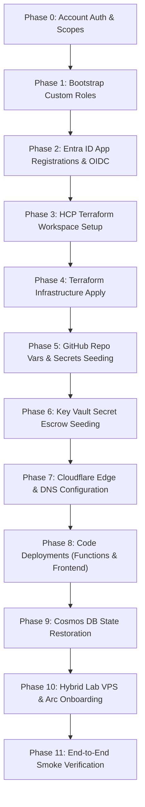

# Cold rebuild runbook

A single ordered, top-to-bottom disaster recovery guide to rebuild the entire HybridCloudWorks platform from bare accounts.

!!! note "Disaster recovery objectives (PLAT-6 / ADR 0011)"
    - **RTO (Recovery Time Objective)**: 8 hours
    - **RPO (Recovery Point Objective)**: 24 hours (nightly Cosmos DB export)
    - **Prerequisites in escrow**: Owner Bitwarden vault holding cloud provider root credentials, domain registrar ownership, and generated shared secrets.

---

## Overview and execution phases



---

## Phase 0: Identity, accounts and CLI sign-in

### 0.1 Prerequisites checklist
Ensure administrative access to the following upstream platforms:
- [x] **Azure Tenant** (`00000000-0000-0000-0000-000000000001`) with Global Administrator or Owner privileges across the four subscriptions:
  - Application Landing Zone: `sub-app-site-prod-cus` (`00000000-0000-0000-0000-000000000002`)
  - Platform Management: `sub-plat-mgmt-prod-cus` (`00000000-0000-0000-0000-000000000003`)
  - Platform Connectivity: `sub-plat-conn-prod-cus` (`00000000-0000-0000-0000-000000000004`)
  - Platform Identity: `sub-plat-ident-prod-cus` (`00000000-0000-0000-0000-000000000005`)
- [x] **Cloudflare**: Account managing zone `hybridcloudworks.com`.
- [x] **GitHub**: Organization owner of `saulpatinojr/HCW-HybridCloudWorks`.
- [x] **HCP Terraform**: Organization `hcw` access with admin rights.
- [x] **Hostinger**: VPS access for the Hybrid Lab host.
- [x] **Bitwarden**: Owner password manager holding escrowed secrets.

### 0.2 Azure CLI authentication
Sign in scoped to the tenant:

```powershell
az login --use-device-code --tenant "<ENTRA_TENANT_ID>"
```

Set subscription context to the Application Landing Zone:

```powershell
az account set --subscription "<SUBSCRIPTION_APP_ID>"
```

Verify the session:

```powershell
az account show -o json | ConvertFrom-Json | Select-Object name, id, tenantId
```

---

## Phase 1: Bootstrap Azure custom roles

HCP Terraform's run identity holds `Contributor` and `Role Based Access Control Administrator`, which intentionally lack permission to create role definitions (`Microsoft.Authorization/roleDefinitions/write`).

Execute the parameterized bootstrap script to create all five required custom roles:

```powershell
pwsh scripts/bootstrap-roles.ps1 `
  -SubscriptionId "<SUBSCRIPTION_APP_ID>" `
  -ManagementSubscriptionId "<SUBSCRIPTION_MGMT_ID>"
```

*POSIX alternative:*
```bash
scripts/bootstrap-roles.sh "<SUBSCRIPTION_APP_ID>" "<SUBSCRIPTION_MGMT_ID>"
```

**Created roles:**
1. `HCW Key Vault Secret Writer` (`infra/roles/keyvault-secret-writer.json`)
2. `HCW Function Config Refresh` (`infra/roles/function-config-refresh.json`)
3. `HCW Function Settings Reader` (`infra/roles/function-settings-reader.json`)
4. `HCW Static Web App Deployer` (`infra/roles/static-web-app-deployer.json`)
5. `HCW Alert Rule Reader` (`infra/roles/alert-rule-reader.json`)

---

## Phase 2: Entra ID app registrations and federated credentials

Run the Entra ID setup script or manually create the required service principals and federated identity credentials:

### 2.1 HCP Terraform run identity
- **App Name**: `id-plat-terraform-prod-cus-01`
- **Federated Credential**:
  - Provider: `app.terraform.io`
  - Subject: `organization:hcw:project:Site:workspace:hcw-azure:run_phase:*`
  - Audience: `api://AzureADTokenExchange`
- **RBAC Grants**:
  - `Contributor` on `sub-app-site-prod-cus` and `sub-plat-mgmt-prod-cus`
  - `Role Based Access Control Administrator` on `sub-app-site-prod-cus` and `sub-plat-mgmt-prod-cus`

### 2.2 GitHub Actions identities (OIDC)
Create application registrations and federated credentials matching `infra/oidc.tf`:
- `id-site-github-deploy-prod-cus-01` (`repo:saulpatinojr/HCW-HybridCloudWorks:environment:production`)
- `id-site-github-reader-prod-cus-01` (`repo:saulpatinojr/HCW-HybridCloudWorks:environment:production`)
- `id-site-github-alert-reader-prod-cus-01` (`repo:saulpatinojr/HCW-HybridCloudWorks:environment:production`)
- `id-site-github-manifest-prod-cus-01` (`repo:saulpatinojr/HCW-HybridCloudWorks:environment:production`)
- `id-site-github-copilot-prod-cus-01` (`repo:saulpatinojr/HCW-HybridCloudWorks:environment:copilot`)

### 2.3 HCWSite API and Lab Agent registration
- **App Name**: `HCWSite API` (`api://<HCWSite-Client-ID>`)
- Define App Role `LabAgent` with value `LabAgent`.
- Register Service Principal `sp-labs-agent-lab-hybrid-prod-cus-01` (managed in Phase 10).

---

## Phase 3: HCP Terraform workspace configuration

In HCP Terraform organization `hcw`, configure workspace `hcw-azure`:

### 3.1 Environment variables
Set category `Environment` (sensitive where indicated):
- `TFC_AZURE_PROVIDER_AUTH` = `true`
- `TFC_AZURE_RUN_CLIENT_ID` = `<Client ID of id-plat-terraform-prod-cus-01>`
- `ARM_TENANT_ID` = `<ENTRA_TENANT_ID>` (sensitive)
- `ARM_SUBSCRIPTION_ID` = `<SUBSCRIPTION_APP_ID>` (sensitive)

### 3.2 Required Terraform variables
Set category `Terraform`:
- `subscription_app` = `<SUBSCRIPTION_APP_ID>` (sensitive)
- `subscription_mgmt` = `<SUBSCRIPTION_MGMT_ID>` (sensitive)
- `subscription_conn` = `<SUBSCRIPTION_CONN_ID>` (sensitive)
- `entra_tenant_id` = `<ENTRA_TENANT_ID>` (sensitive)
- `entra_api_audience` = `api://<HCWSite-Client-ID>`
- `cloudflare_api_token` = `<CLOUDFLARE_API_TOKEN>` (sensitive; DNS + Transform Rules edit)
- `cloudflare_zone_id` = `<CLOUDFLARE_ZONE_ID>`
- `cloudflare_origin_secret` = `<CF_ORIGIN_SECRET>` (sensitive; from Bitwarden)
- `budget_alert_email` = `admin@hybridcloudworks.com`

---

## Phase 4: Terraform infrastructure apply

1. Trigger a plan in workspace `hcw-azure`.
2. Inspect the plan output:
   - Resource Groups: `rg-web-site-prod-cus`, `rg-data-site-prod-cus`, `rg-ai-site-prod-cus`, `rg-mgmt-plat-prod-cus`, `rg-lab-hybrid-prod-cus`.
   - Key Vault: `kv-site-prod-cus-01` (purge protection enabled).
   - Storage accounts: `stsiteprodcus01`, `stfnsprodcus01`.
   - Cosmos DB: `cosmos-site-prod-cus` (Serverless, periodic backup, datacenter sentinel).
   - Function App: `func-site-prod-cus-01` with `@Microsoft.KeyVault(...)` app settings.
   - Static Web App: `swa-site-prod-cus-01`.
   - Observability: `log-plat-prod-cus-01`, Application Insights `appi-site-prod-cus-01`, alerting fabric.
   - Cloudflare Ruleset: `cloudflare_ruleset.origin_secret` stamping `x-hcw-origin-secret`.
3. Confirm and apply the run.
4. Record all Terraform outputs.

---

## Phase 5: GitHub repository variables and secrets seeding

From a workstation with `gh` authenticated to the repository, seed variables from Terraform outputs:

```powershell
pwsh scripts/set-github-variables.ps1
```

Set the required repository secrets:
- `TFC_TOKEN`: HCP Terraform user or team API token.
- `MANIFEST_APP_PRIVATE_KEY`: Private PEM key of the repository GitHub App.

Ensure GitHub Environment `production` is configured:
- Required Reviewers: `saulpatinojr` and `hcw-architect` (either can approve).
- Deployment branch policy: **Selected branches &rarr; `main` only**.

---

## Phase 6: Key Vault secret escrow seeding

Using the authoritative **Where to Re-obtain** paths documented in [Required inputs §4.6](../standards/required-inputs.md#46-key-vault-secrets-kv-site-prod-cus-01), seed all 30 Key Vault secrets into `kv-site-prod-cus-01`:

```powershell
# Generated high-entropy secrets (retrieve from Bitwarden escrow, or generate fresh with `openssl rand -hex 32` and immediately escrow in Bitwarden):
az keyvault secret set --vault-name "kv-site-prod-cus-01" --name "CF-ORIGIN-SECRET" --value "<FROM_BITWARDEN>"
az keyvault secret set --vault-name "kv-site-prod-cus-01" --name "CLIENT-IP-SALT" --value "<FROM_BITWARDEN>"
az keyvault secret set --vault-name "kv-site-prod-cus-01" --name "PREVIEW-SIGNING-SECRET" --value "<FROM_BITWARDEN>"

# Upstream API Keys & Tokens:
az keyvault secret set --vault-name "kv-site-prod-cus-01" --name "GEMINI-API-KEY" --value "<KEY>"
az keyvault secret set --vault-name "kv-site-prod-cus-01" --name "ANTHROPIC-API-KEY" --value "<KEY>"
az keyvault secret set --vault-name "kv-site-prod-cus-01" --name "OPENAI-API-KEY" --value "<KEY>"
az keyvault secret set --vault-name "kv-site-prod-cus-01" --name "NVIDIA-API-KEY" --value "<KEY>"
az keyvault secret set --vault-name "kv-site-prod-cus-01" --name "ELEVENLABS-API-KEY" --value "<KEY>"
az keyvault secret set --vault-name "kv-site-prod-cus-01" --name "AZURE-SPEECH-KEY" --value "<KEY>"
az keyvault secret set --vault-name "kv-site-prod-cus-01" --name "FIRECRAWL-API-KEY" --value "<KEY>"
az keyvault secret set --vault-name "kv-site-prod-cus-01" --name "REPLICATE-API-KEY" --value "<KEY>"
az keyvault secret set --vault-name "kv-site-prod-cus-01" --name "PUBLER-API-KEY" --value "<KEY>"
az keyvault secret set --vault-name "kv-site-prod-cus-01" --name "PUBLER-WORKSPACE-ID" --value "<ID>"
az keyvault secret set --vault-name "kv-site-prod-cus-01" --name "RESEND-API-KEY" --value "<KEY>"
az keyvault secret set --vault-name "kv-site-prod-cus-01" --name "LINKIE-API-KEY" --value "<KEY>"
az keyvault secret set --vault-name "kv-site-prod-cus-01" --name "TELEGRAM-BOT-TOKEN" --value "<KEY>"
az keyvault secret set --vault-name "kv-site-prod-cus-01" --name "TELEGRAM-CHAT-ID" --value "<ID>"
az keyvault secret set --vault-name "kv-site-prod-cus-01" --name "PODBEAN-CLIENT-ID" --value "<ID>"
az keyvault secret set --vault-name "kv-site-prod-cus-01" --name "PODBEAN-CLIENT-SECRET" --value "<SECRET>"
az keyvault secret set --vault-name "kv-site-prod-cus-01" --name "STREAMYARD-API-KEY" --value "<KEY>"
az keyvault secret set --vault-name "kv-site-prod-cus-01" --name "YOUTUBE-API-KEY" --value "<KEY>"
az keyvault secret set --vault-name "kv-site-prod-cus-01" --name "PLAUD-EMBEDDED-CLIENT-ID" --value "<ID>"
az keyvault secret set --vault-name "kv-site-prod-cus-01" --name "PLAUD-EMBEDDED-API-KEY" --value "<KEY>"
az keyvault secret set --vault-name "kv-site-prod-cus-01" --name "AWS-ACCESS-KEY-ID" --value "<ID>"
az keyvault secret set --vault-name "kv-site-prod-cus-01" --name "AWS-SECRET-ACCESS-KEY" --value "<KEY>"
az keyvault secret set --vault-name "kv-site-prod-cus-01" --name "GCP-BILLING-API-KEY" --value "<KEY>"
az keyvault secret set --vault-name "kv-site-prod-cus-01" --name "QLTY-API-TOKEN" --value "<TOKEN>"
az keyvault secret set --vault-name "kv-site-prod-cus-01" --name "TURNSTILE-SECRET-KEY" --value "<KEY>"
az keyvault secret set --vault-name "kv-site-prod-cus-01" --name "CODER-URL" --value "https://coder.lab.hybridcloudworks.com"
az keyvault secret set --vault-name "kv-site-prod-cus-01" --name "CODER-STATUS-TOKEN" --value "<TOKEN>"
```

---

## Phase 7: Cloudflare Edge and DNS configuration

1. **DNS Apex and WWW Bindings**:
   - In Cloudflare DNS, configure CNAME records pointing `hybridcloudworks.com` and `www` to the Static Web App default hostname (`*.azurestaticapps.net`).
   - Validate custom domain binding in Azure Static Web App (`swa-site-prod-cus-01`).
2. **API Subdomain**:
   - Verify `api-azure.hybridcloudworks.com` CNAME points to `func-site-prod-cus-01.azurewebsites.net` (Proxied = `true`).
3. **Turnstile Widgets**:
   - Create Turnstile widget for `hybridcloudworks.com` in Cloudflare dashboard (Managed mode).
   - Set site key in GitHub variable `VITE_TURNSTILE_SITE_KEY`.
   - Seed secret key in Key Vault `TURNSTILE-SECRET-KEY`.
4. **Availability Probe & Security**:
   - Enable Bot Fight Mode.
   - Deploy Edge Availability Probe Worker per [Availability probe runbook](availability-probe.md).

---

## Phase 8: Application code deployments

1. **Deploy Azure Functions**:
   Trigger GitHub Actions workflow `deploy-functions.yml` on branch `main`.
   ```bash
   gh workflow run deploy-functions.yml --ref main
   ```
2. **Deploy Azure Frontend**:
   Trigger GitHub Actions workflow `deploy-azure-frontend.yml` on branch `main`.
   ```bash
   gh workflow run deploy-azure-frontend.yml --ref main
   ```
3. **Restart Function App**:
   Trigger reference refresh to bind all Key Vault secrets:
   ```powershell
   az functionapp restart --name "func-site-prod-cus-01" --resource-group "rg-web-site-prod-cus"
   ```

---

## Phase 9: Cosmos DB state restoration

Restore production database collections from the nightly out-of-account export storage account:

1. Identify the latest complete backup export in `stsiteprodcus01` (container `cosmos-export`):
   ```powershell
   az storage blob list `
     --account-name "stsiteprodcus01" `
     --container-name "cosmos-export" `
     --auth-mode login `
     --query "[?ends_with(name, '.json.gz')].name" -o tsv
   ```
2. Run dry-run restore validation:
   ```bash
   node scripts/restore-cosmos-export.mjs --dry-run
   ```
3. Execute restore to production Cosmos DB (`cosmos-site-prod-cus`):
   ```bash
   node scripts/restore-cosmos-export.mjs
   ```
4. Verify document counts against [Cosmos restore runbook](cosmos-restore.md).

---

## Phase 10: Hybrid Lab host (VPS) rebuild

Follow [Labs host runbook](labs-host.md) to reconstruct the Hostinger VPS:

1. **Provision VPS**: Hostinger hPanel &rarr; Ubuntu 26.04 LTS.
2. **Arc Onboarding**:
   ```powershell
   pwsh scripts/lab/Register-LabArc.ps1 -Connect
   ```
3. **Lab Agent Registration**:
   ```powershell
   pwsh scripts/lab/Register-LabAgent.ps1
   ```
4. **Run Ansible Configuration**:
   ```bash
   cd lab-host/ansible && ansible-playbook -i inventory.ini site.yml
   ```
5. **HashiCorp Vault Initialisation**:
   Initialize Vault, store recovery shares in Bitwarden, and configure Azure Key Vault auto-unseal.
6. **Caddy & TLS DNS-01**:
   Seed Caddy's Cloudflare API token into `/etc/caddy/env` and restart `caddy` to issue wildcard `*.lab.hybridcloudworks.com`.

---

## Phase 11: End-to-end verification and smoke testing

Run automated verification checks:

1. **Alerting Fabric State Verification**:
   ```bash
   node scripts/verify-alert-state.mjs
   ```
   Must exit `0` with all alert rules confirmed enabled.

2. **Secret Resolution Check**:
   ```bash
   node scripts/check-unresolved-secrets.mjs
   ```
   Must report `0` unresolved secrets.

3. **Public API Health Check**:
   ```bash
   curl -fsS -i "https://api-azure.hybridcloudworks.com/api/public/addons/migration/status"
   ```
   Must return `200 OK`.

4. **Frontend Reachability**:
   ```bash
   curl -fsS -I "https://hybridcloudworks.com"
   ```
   Must return `200 OK` with valid security headers (`Content-Security-Policy`, `Strict-Transport-Security`).
